# Relay Ứng dụng trò chuyện bằng PHP và WebSocket

WebSocket và giao tiếp thời gian thực

Học phần 503073 Lập trình Web và Ứng dụng

Học kỳ 1 Năm học 2026 2027

## Tóm tắt

Relay minh họa cách dùng kết nối hai chiều liên tục để xây dựng ứng dụng trò chuyện nhiều phòng. Hệ thống kết hợp HTTP bằng PHP, tiến trình WebSocket Workerman, JavaScript trình duyệt, Nginx và SQLite. Ba phòng dùng chung cung cấp tin nhắn, danh sách trực tuyến gộp theo tài khoản, trạng thái đang nhập và lịch sử. Cookie có chữ ký nhận diện phiên được cả HTTP và WebSocket kiểm tra. Máy chủ xác minh dữ liệu, quyền trong phòng, giới hạn tài khoản và lưu trước khi phát.

Bản kiểm chứng gốc ngày 22/10/2026 gồm 28 bài PHPUnit với 78 xác nhận và bảy nhóm tích hợp. Đợt hoàn thiện ngày 05/11/2026 đạt 40 bài PHPUnit/135 xác nhận, 9/9 nhóm HTTP/WebSocket và 14/14 bước trình duyệt, không có lỗi JavaScript. Đợt này kiểm đăng ký, tin riêng, vòng đời nhóm, phân trang/tìm/xuất lịch sử, bản nháp lưu lâu hơn và bố cục điện thoại/máy tính; JSON và ảnh chụp được đính kèm. Kết quả gốc và các lượt cập nhật được giữ riêng theo ngày.

WebSocket là phương thức truyền, không tự cung cấp xác thực, phân quyền, lịch sử hoặc giao đúng một lần. Relay xây dựng cơ chế ứng dụng tương ứng nhưng giữ giới hạn: một worker giữ trạng thái tạm, SQLite ghi đồng bộ, mỗi trang lịch sử tối đa 50 tin và chưa kiểm chứng TLS công khai. Tải trang cũ, tìm toàn lịch sử phòng và xuất hội thoại duyệt tuần tự qua trang. Báo cáo đối chiếu nguyên lý, thiết kế, mã nguồn, minh chứng và phương pháp đo trong phạm vi này.

<!-- PAGE -->
# Chương 1 Giới thiệu

## 1.1 Vấn đề giao tiếp

Website thông thường phản hồi khi người dùng mở trang, gửi biểu mẫu hoặc lấy tài liệu. Trong phòng chat, người nhận mong thấy tin của người khác mà không tải lại. Trạng thái đang nhập và trực tuyến cũng thay đổi ngoài các lần yêu cầu chủ động. Ứng dụng cần đường truyền cập nhật kịp thời, đồng thời xác định ai được gửi và nhận.

Polling giải quyết bằng cách hỏi máy chủ định kỳ. Chu kỳ ngắn giảm chờ nhưng tạo nhiều yêu cầu khi không có thay đổi. WebSocket giữ kết nối để hai bên gửi độc lập, phù hợp hội thoại; đổi lại ứng dụng phải quản lý vòng đời, kiểm tra sự kiện, phân quyền và khôi phục. Giao thức không tự biến demo thành hệ thống chat tin cậy [1][3].

Relay hướng đến sinh viên và nhóm nhỏ. Người dùng đăng nhập bằng tài khoản mẫu, chọn Trò chuyện chung, Kỹ thuật hoặc Nhóm học tập rồi trao đổi văn bản. Mỗi phòng có dòng tin, danh sách trực tuyến và dấu đang nhập ngắn hạn. Bản tiếng Việt bổ sung công cụ để đọc, tìm và tiếp tục công việc thuận tiện hơn.

Câu hỏi của đồ án là cách kết hợp HTTP và tiến trình WebSocket trong PHP để minh họa hành vi thời gian thực dễ quan sát, có kiểm soát và có thể lặp lại. Đánh giá tập trung chức năng, kiểm thử và so sánh đường nhận polling/WS trên cùng tải local; không kết luận một phương thức luôn vượt trội.

Việc tách giao tiếp thành hai đường còn có ý nghĩa học tập. Người đọc có thể quan sát phản hồi HTTP cho đăng nhập, đối chiếu mã trạng thái khi sai quyền, rồi quan sát cùng một danh tính đi vào kênh WebSocket. Khi máy chủ gửi sự kiện không có yêu cầu HTTP tương ứng từ người nhận, tính chất đẩy của hệ thống trở nên cụ thể. Bài demo vì thế cần cả hành vi đúng lẫn tình huống lỗi để giải thích trách nhiệm ứng dụng.

Đồ án không chỉ thay giá trị trên màn hình theo chu kỳ. Hội thoại có nhiều người, nhiều phòng và dữ liệu tồn tại qua tiến trình; một lỗi về thành viên có thể khiến người dùng thấy nội dung sai phòng. Các yêu cầu về lưu trữ và phiên tạo cơ hội đánh giá tính nhất quán giữa HTTP, WebSocket và trạng thái giao diện, thay vì chỉ xác nhận socket đã mở.

## 1.2 Mục tiêu và phạm vi

Mục tiêu chính là nhắn tin hai chiều, máy chủ đẩy sự kiện và phát theo phòng trong ứng dụng có hướng dẫn cài. Mục tiêu hỗ trợ gồm phiên dùng chung, dữ liệu tồn tại sau restart, trực tuyến đúng khi mở nhiều thẻ và trạng thái mất kết nối dễ hiểu.

| Mục tiêu | Tiêu chí chấp nhận | Nhóm minh chứng |
| --- | --- | --- |
| Trao đổi trực tiếp | Hai tài khoản nhận cùng ID đã lưu, không tải lại | Trình duyệt, tích hợp |
| Cô lập phòng | Không lọt chat, đang nhập, trực tuyến | Hub, tích hợp |
| Xác thực chung | Phiên sai bị từ chối, đăng xuất thu hồi socket | Phiên, đăng xuất |
| Bền vững | Dấu nhận diện còn sau restart HTTP/WS | Kiểm tra runtime |
| Vòng đời | Khóa gửi khi mất mạng, nối lại và gộp ID | Trình duyệt |
| Phòng vệ | Từ chối schema sai, quá dài, nhị phân, gửi dồn | Validator, giao thức |
| Tái lập | Cài từ nguồn giải nén bằng lệnh hướng dẫn | Cài sạch |

Phạm vi kiểm chứng dùng ba tài khoản mẫu, ba phòng chung và tối đa 50 tin mỗi trang. Bản hoàn thiện bổ sung đăng ký tài khoản, tin nhắn riêng giữa bạn bè và quản lý vòng đời nhóm riêng. Chưa có tệp đính kèm, vai trò quản trị, kiểm duyệt hoặc mở rộng nhiều máy. PHP 8.3, Workerman, SQLite, Nginx và Docker là lựa chọn dự án. JavaScript mở WebSocket và cập nhật DOM; không có bước build giao diện Node.js.

Chương 2 trình bày nguyên lý/phương án, chương 3 thiết kế, chương 4 triển khai/kiểm chứng/phép đo, chương 5 đánh giá và phát triển. Mã nguồn, hợp đồng và dữ liệu đo đi cùng báo cáo để người đọc kiểm tra nhận định.

<!-- PAGE -->
# Chương 2 Cơ sở lý thuyết và phân tích so sánh

## 2.1 HTTP và nhu cầu cập nhật kịp thời

HTTP có ranh giới yêu cầu/phản hồi rõ: lấy lịch sử nhận JSON hữu hạn, gửi thông tin đăng nhập nhận trạng thái/cookie. Những thao tác này vẫn cần trong ứng dụng thời gian thực. WebSocket không khiến HTTP thừa.

Cập nhật hội thoại không phụ thuộc lịch chủ động của người nhận. Có thể lặp yêu cầu ngắn, giữ yêu cầu dài hoặc mở luồng sự kiện máy chủ. Mỗi cách đổi thời điểm giao tin, phát hiện lỗi và vận hành. Chọn theo hướng truyền, tần suất và hạ tầng.

RFC 6455 chuẩn hóa WebSocket năm 2011. Sau thương lượng, dữ liệu chia khung trên kết nối liên tục, hai bên chủ động gửi mà không cần một vòng HTTP đầy đủ cho mỗi tin [1]. Kết nối vẫn có thể mất do máy ngủ, proxy timeout, mạng hoặc restart. Ứng dụng xác định danh tính, quyền và khôi phục.

Lỗi HTTP gắn với một yêu cầu/mã trạng thái. WS có nhiều sự kiện trong một vòng đời: 101 có thể thành công nhưng sự kiện sau đó sai. Relay trả lỗi JSON sau Upgrade và đóng khi phiên mất hiệu lực hoặc không thể tiếp tục.

## 2.2 Bắt tay và ranh giới proxy

Relay dùng Upgrade qua HTTP/1.1. Trình duyệt gửi `/ws`, tiêu đề Upgrade và khóa kết nối. Workerman thương lượng, trả `101 Switching Protocols` cùng giá trị chấp nhận theo RFC. Đây là đồng ý giao thức, không phải đăng nhập [1].

Cookie/Origin đi cùng yêu cầu. Gateway kiểm tra Origin chính xác và tra phiên ký trong SQLite. Chữ ký đúng chưa đủ: bản ghi phải tồn tại, còn hạn, chưa thu hồi và có người dùng. Phiên khách chỉ hỗ trợ khởi tạo CSRF.

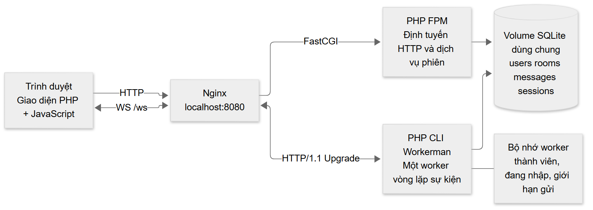

Nginx chuyển API/trang sang PHP-FPM, `/ws` sang Workerman. Upgrade/Connection là tiêu đề từng chặng nên phải chuyển rõ [9]. Cả hai đường cùng Origin/cookie. Mỗi tiến trình mở PDO riêng tới volume chung; biến toàn cục PHP không chia sẻ phiên giữa chúng.

Mô tả HTTP/1.1 áp dụng cấu hình này, không khái quát mọi WebSocket trên mọi phiên bản HTTP. Triển khai công khai còn cần tên miền, TLS và CSP.

Ở ranh giới proxy, việc trình duyệt giữ một Origin giúp tránh cấu hình cookie xuyên miền không cần thiết. Tuy vậy, cùng Origin không thay kiểm tra phiên: một yêu cầu có thể thiếu cookie, cookie bị sửa hoặc tham chiếu bản ghi đã thu hồi. Gateway phải giải quyết từng điều kiện trước khi nhận kết nối vào Hub. Khi dịch vụ xác thực không truy cập được dữ liệu, hành vi là từ chối dịch vụ thay vì cấp quyền dựa trên thông tin chưa kiểm chứng.

Các cổng nội bộ không được công bố để người dùng bỏ qua Nginx và đi vào Workerman trực tiếp. Trong môi trường local, việc bind Nginx vào loopback cũng giới hạn phạm vi truy cập theo thiết kế. Nếu thay bằng máy chủ công khai, cần rà lại toàn tuyến; cấu hình đã chạy local không tự trở thành cấu hình TLS hợp lệ.

## 2.3 Khung dữ liệu và lưu lượng điều khiển

Khung chứa opcode, độ dài, cờ phân mảnh và masking. Tin văn bản/nhị phân có thể gồm nhiều khung. Ping/pong/close là khung điều khiển. JSON `chat:send` là quy ước ứng dụng, không phải opcode [1].

Workerman phân tích khung, masking, continuation và điều khiển. Ứng dụng nhận tin đã ghép, kiểm tra loại/kích thước, giải mã JSON và schema. Bộ tiếp hợp nhớ tin bắt đầu bằng nhị phân để từ chối kể cả nội dung giống JSON; không tự viết bộ phân tích giao thức.

Masking từ máy khách là yêu cầu RFC, không mã hóa. TLS cung cấp mã hóa/xác thực máy chủ cho `wss:`. Demo loopback dùng `ws:`, không gọi lưu lượng này là mã hóa [1][4].

| Lớp | Ví dụ | Thành phần |
| --- | --- | --- |
| Giao thức | Masking, phân mảnh, ping/pong | Workerman |
| Biểu diễn | JSON UTF-8, tối đa 8192 byte | Validator |
| Schema | roomId số nguyên, đúng tập trường | Validator |
| Quyền | Socket tham gia phòng yêu cầu | EventHandler |
| Nghiệp vụ | Lưu trước khi phát | ChatService, repository |

Giới hạn khung chừa tối đa 14 byte tiêu đề; ứng dụng kiểm lại JSON ghép. Nội dung 500 mã ký tự độc lập số byte, cần thử Unicode/phân mảnh.

## 2.4 Sự kiện và phát tin theo phòng

Thông điệp gồm `type`, `payload`. `room:join` đổi thành viên, `chat:send` đề nghị lưu tin, `typing:set` cập nhật tạm. Máy chủ gửi xác nhận hoặc ảnh chụp trạng thái rõ; trình duyệt không đoán từ việc socket mở.

Sau lưu, Workerman đẩy `chat:new` tới mọi socket còn hợp lệ trong phòng, kể cả người gửi. Cùng bản ghi chuẩn/ID giúp gộp HTTP và WS, không cần bản sao lạc quan với ID giả.

Hub định tuyến theo phòng đang tham gia, không gửi mọi dữ liệu cho mọi socket. Chat, trực tuyến, đang nhập dùng cùng ranh giới; đây là tính đúng và quyền riêng tư trong phòng. Danh tính lấy từ phiên, không tin user ID do máy khách gửi. Mỗi sự kiện kiểm tra roomId, từ chối tên/trường lạ [4].

<!-- PAGE -->
Trạng thái trực tuyến là ảnh chụp các tài khoản có ít nhất một socket trong phòng, không phải danh sách tất cả phiên đã đăng nhập. Một người đăng nhập nhưng không có socket hợp lệ trong phòng không nhất thiết xuất hiện. Ngược lại, đóng một thẻ không đồng nghĩa tài khoản đã ngoại tuyến nếu thẻ khác vẫn tham gia. Thiết kế gộp theo tài khoản được kiểm tra độc lập với số kết nối.

Trạng thái đang nhập là dữ liệu tạm, không được ghi vào lịch sử tin nhắn. Đó là dấu hiệu để người khác hiểu hoạt động sắp xảy ra, không phải một cam kết người đó sẽ gửi tin. TTL phía máy chủ giúp tránh dấu nhập treo khi máy khách mất mạng hoặc không gửi được sự kiện dừng. Các snapshot thay toàn bộ danh sách để máy khách không phải suy diễn từ chuỗi sự kiện thêm/xóa có thể bị lỡ.

## 2.5 Vòng đời và khôi phục

Trạng thái gồm kết nối, mở, tham gia phòng, tải/gộp lịch sử, sẵn sàng, nối lại, đăng xuất. Socket mở chưa đủ gửi: còn cần xác nhận phòng. Nút Gửi phản ánh điều đó.

Máy khách chờ 1/2/4/8/10 giây khi thử lại. Mở lại thì `room:join`, nhận xác nhận rồi lấy lịch sử. Tin đến trong lúc HTTP được giữ theo ID; gộp snapshot không tạo hai dòng cùng bản ghi. AbortController/thế hệ/phòng loại phản hồi phòng cũ trễ.

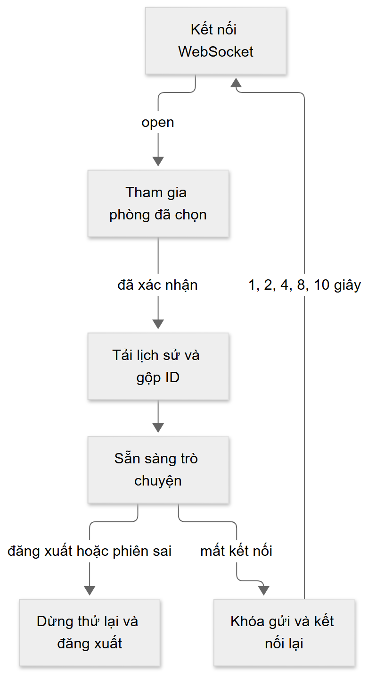

Tin có thể commit nhưng người gửi chưa nhận echo khi mạng mất. Tự gửi lại không có khóa chống trùng có thể thêm bản ghi khác. Relay giữ nội dung để kiểm tra, không tự gửi lại. Bản nháp hỗ trợ thao tác, không bảo đảm giao đúng một lần.

Mỗi yêu cầu lấy tối đa 50 tin. `beforeId` cho phép đọc trang cũ hơn; tìm kiếm duyệt toàn bộ lịch sử phù hợp trong phòng và xuất tải từng trang tới khi hết dữ liệu. Map ID loại trùng hiển thị cùng bản ghi. Tuy vậy, máy khách không có cursor phát lại bền vững cho mọi sự kiện sau gián đoạn; tin gửi chưa rõ kết quả vẫn cần người dùng kiểm tra.

Thời điểm chuyển phòng là một trường hợp tranh chấp rõ. Người dùng có thể chọn Kỹ thuật rồi Nhóm học tập trước khi yêu cầu lịch sử Kỹ thuật trả về. Hủy yêu cầu giúp giảm công việc nhưng không đủ để chứng minh phản hồi sẽ không đến; kiểm tra thế hệ và ID phòng là lớp quyết định áp dụng kết quả. Bộ thử cố ý làm chậm yêu cầu cũ để thực sự tạo điều kiện này.

Tương tự, dữ liệu lịch sử và sự kiện trực tiếp có thể chồng nhau. Một tin được lưu sau khi tham gia nhưng trước khi truy vấn lịch sử hoàn tất có thể đi qua cả hai đường. Dùng ID chuẩn từ cơ sở dữ liệu làm khóa là đủ để loại hai biểu diễn của cùng bản ghi. Nó không loại hai lần INSERT khác nhau do thử lại cùng nội dung, vì chúng có ID khác nhau.

## 2.6 Xác thực và an toàn thông điệp

Mật khẩu dùng băm PHP. Cookie ký, HttpOnly, SameSite=Lax, Secure khi HTTPS. DB giữ băm token, hạn và thu hồi. Đăng nhập xoay phiên/thu hồi cũ; HTTP/WS cùng tra nguồn [7].

HTTP thay đổi cần Origin/CSRF. WS đối chiếu Origin trước Upgrade. Phiên tiếp tục kiểm ở sự kiện, trước giao tin và mỗi giây; handshake không cấp quyền vĩnh viễn [4].

Schema nhận trường xác định, UTF-8 không rỗng, 500 mã ký tự và JSON 8192 byte. Cửa sổ trượt cho 20 tin được chấp nhận/60 giây/tài khoản trên mọi socket. SQL có tham số [6], DOM dùng `textContent` để `<script>` hiển thị văn bản. Chưa có kiểm toán bảo mật toàn diện hoặc cam kết dịch vụ Internet.

CSRF và kiểm Origin xử lý ranh giới trình duyệt, còn kiểm schema xử lý nội dung thông điệp. Một kết nối hợp lệ có thể gửi JSON không hợp lệ hoặc thao tác phòng chưa tham gia. Không thể thay kiểm quyền ứng dụng bằng việc đã vượt qua handshake. Việc tách các mã lỗi máy đọc và thông báo tiếng Việt cho phép kiểm thử tiếp tục so mã ổn định trong khi người dùng đọc lỗi dễ hiểu.

Cookie HttpOnly giảm khả năng JavaScript trang lấy token trực tiếp, nhưng không phải cách xử lý nội dung chat. Nội dung phải được render theo ngữ cảnh văn bản và SQL phải dùng tham số. Chuỗi giống SQL trong tin nhắn có thể lưu hợp lệ vì nó là dữ liệu; chuỗi giống thẻ script cũng có thể hiển thị nguyên mà không chạy. Hai bài kiểm tra xác nhận hai lớp phòng vệ khác nhau, không chỉ tìm một từ khóa nguy hiểm trong nội dung.

## 2.7 Đồng thời và lưu trữ

Workerman dùng vòng lặp sự kiện, nhiều socket trong một tiến trình, không tạo tiến trình mỗi tin. Phòng/typing/bộ đếm trong RAM cho thiết kế ngắn gọn nhưng giới hạn một worker.

Thêm worker khi chưa chia sẻ trạng thái tạo phòng/bộ đếm khác nhau. Cần trạng thái chung, pub/sub và kiểm quyền tại từng worker. SQLite WAL hỗ trợ đọc/ghi cùng tồn tại; ghi đồng bộ vẫn có thể chặn vòng lặp và chỉ một bên ghi [8]. Volume phải giữ DB/WAL/SHM với quyền phù hợp.

Bộ đệm gửi có giới hạn để người nhận chậm không giữ vô hạn. Thử 2/10/20 socket chứng minh phát đúng ở phạm vi đó, không tìm thông lượng tối đa. Mở rộng cần đo dài, tài nguyên và chính sách người nhận chậm.

## 2.8 So sánh các phương án

| Phương án | Cơ chế | Phù hợp | Đánh đổi |
| --- | --- | --- | --- |
| Polling ngắn | HTTP hỏi định kỳ | Dữ liệu đổi ít, hạ tầng đơn giản | Chờ chu kỳ, hỏi cả khi không đổi |
| Polling dài | Giữ yêu cầu tới dữ liệu/hết hạn | Dự phòng khi thiếu streaming | Kết nối chờ, timeout/mở lại |
| SSE | Luồng máy chủ → trình duyệt | Tiến độ, thông báo một chiều | Gửi lên cần kênh khác, proxy buffer |
| WebSocket | Hai chiều trên kênh chia khung | Chat, hoạt động độc lập hai chiều | Tự nối lại, trạng thái, quyền, luồng |

SSE phù hợp bảng tiến độ/thông báo [2]; HTTP gửi kết hợp SSE nhận cũng xây được chat. WS phù hợp Relay vì chat/đang nhập phát sinh độc lập hai chiều. HTTP vẫn cho tác vụ hữu hạn.

Thí nghiệm chỉ đổi kênh nhận, giữ người gửi WS, danh tính, phòng, DB và máy chủ. Chu kỳ hỏi một giây là lựa chọn đo, không đặc tính cố định polling. Chi phí vận hành/tin cậy vẫn xem riêng.

<!-- PAGE -->
# Chương 3 Yêu cầu và thiết kế hệ thống

Tiêu chí kiểm thử được chọn để có cả ví dụ thành công và phản ví dụ. Hai tài khoản nhận tin chứng minh đường chính, nhưng không chứng minh cô lập. Cần người thứ hai đổi phòng rồi kiểm tra không nhận tin, typing hoặc presence của phòng cũ. Đăng nhập đúng chứng minh khả dụng, còn phiên sửa hoặc bị thu hồi chứng minh ứng dụng không chỉ dựa vào việc cookie có tồn tại.

Giao diện cũng là một phần của hợp đồng hành vi. Khi dữ liệu chưa sẵn sàng cần trạng thái tải, khi không có tin cần trạng thái rỗng, khi mạng mất cần khóa gửi và hướng dẫn tiếp tục. Một lỗi khởi tạo không được trông giống đăng nhập sai. Tùy chọn tiếng Việt phải áp dụng cả tên trợ năng và thông báo động để trải nghiệm không chỉ được dịch ở các nút dễ thấy.

## 3.1 Yêu cầu

Người dùng đăng nhập, xem/chuyển phòng, gửi/nhận, xem lịch sử, trực tuyến/đang nhập và đăng xuất. Không phát sang phòng khác; nhiều thẻ cùng tài khoản chỉ hiện một lần trong phòng.

Yêu cầu phi chức năng gồm dễ cài, lỗi dễ hiểu, phản hồi khi mất mạng, lưu trước phát, kiểm đầu vào và kiểm tra lặp lại. Đây là tiêu chí quan sát, không phải tuyên bố công suất.

Bản tiếng Việt giữ API/dữ liệu. Tìm kiếm, bản nháp, trích dẫn, xuất TXT, hiển thị chạy tại trình duyệt. Dữ liệu người dùng gửi giữ nguyên, không tự dịch hoặc đổi danh tính.

## 3.2 Thành phần

| Thành phần | Trách nhiệm |
| --- | --- |
| Nginx | Một Origin, tài nguyên, FastCGI/Upgrade |
| Controller/middleware | API, đăng nhập, CSRF, quyền |
| SessionService | Ký, tra, xoay, thu hồi phiên |
| Repository | SQL tham số, dữ liệu chuẩn |
| Gateway | Socket, handshake, heartbeat, lỗi |
| EventHandler/ChatService | Kiểm sự kiện/phòng, lưu, phát |
| RoomHub/RateLimiter | Thành viên, typing, bộ đếm RAM |
| Trình duyệt | Kết nối, gộp ID, biểu mẫu/công cụ |

Workerman mở PDO sau worker startup, tránh kết nối kế thừa qua fork. PHP-FPM không chia biến RAM với WS. Nginx là cổng công bố duy nhất; WS/FPM ở mạng Docker. Triển khai tên miền cần đổi đồng bộ Origin, HTTPS, cookie và CSP.

## 3.3 Dữ liệu bền vững

Bốn bảng: `users` có username duy nhất, display_name/password_hash; `rooms` có ba phòng; `messages` liên kết tác giả/phòng, nội dung/thời gian UTC; `sessions` có băm token, CSRF, hạn/thu hồi và user ID cho phép rỗng để có phiên khách.

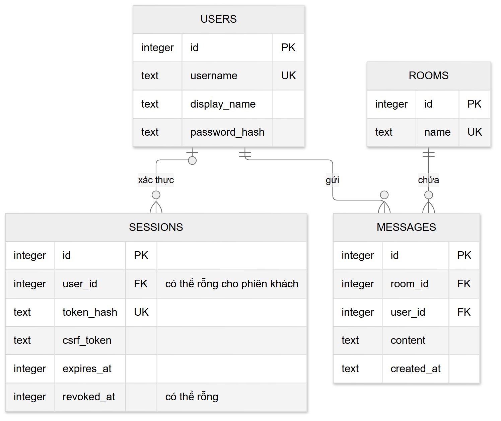

Khóa ngoại giữ tham chiếu. Chỉ mục `(room_id,id)` hỗ trợ lịch sử: lấy ID giảm dần có LIMIT rồi đảo để trả mới nhất theo thứ tự tăng. Chọn tăng dần rồi LIMIT sẽ nhầm 50 tin cũ nhất.

ID là khóa gộp, không giao thức tin cậy hoàn chỉnh. UTC dùng hiển thị; phép đo dùng đồng hồ đơn điệu riêng, không trừ đồng hồ máy chủ/trình duyệt chưa đồng bộ. Seed thêm phần thiếu, chỉ chào khi bảng tin rỗng; chạy lại giữ hội thoại. Gói nguồn loại `.env`/DB thực, giữ tài khoản giả/lệnh seed.

Lược đồ phiên cho phép tách giá trị trình duyệt giữ với giá trị cơ sở dữ liệu lưu. Khi nhận cookie, dịch vụ xác minh chữ ký và tra băm token, sau đó kiểm tra hạn và thu hồi. Đổi phiên khi đăng nhập làm cookie khách cũ không tiếp tục được dùng như phiên đã xác thực. Cách làm này cũng cho Workerman tra lại trạng thái mà không phụ thuộc phiên trong RAM PHP-FPM.

Dữ liệu mẫu chỉ nhằm giúp người nhận mã chạy lại chức năng. Việc chuyển bốn lời chào có sẵn sang tiếng Việt dùng nội dung, tài khoản và phòng đã biết để giới hạn cập nhật; không xóa lịch sử hoặc dịch lại tin người dùng. Tên phòng lưu bằng mã tên cũ được ánh xạ tại giao diện, tránh tạo thêm phòng khi chạy seed trên dữ liệu đang có.

## 3.4 Hợp đồng API và sự kiện

HTTP trả `{data:...}` hoặc `{error:{code,message}}`. User có `id`, `username`, `displayName`; Message có `id`, `roomId`, `user`, `content`, `createdAt`. Không trả bí mật/băm mật khẩu.

| Đường dẫn | Mục đích | Ràng buộc |
| --- | --- | --- |
| GET `/api/auth/me` | User/CSRF, tạo phiên khách | Token ở cookie |
| POST `/api/auth/login` | Đăng nhập/xoay phiên | JSON, Origin, CSRF |
| POST `/api/auth/logout` | Thu hồi dùng chung | Thu hồi trước xóa cookie |
| GET `/api/rooms` | Danh sách phòng | Đăng nhập |
| GET `/api/rooms/{id}/messages?limit=50` | Tin mới nhất theo ID | Đăng nhập, limit 1..50 |

WS dùng `{type,payload}` với `room:join`, `chat:send`, `typing:set`; máy chủ trả `room:joined`, `chat:new`, `room:presence`, `room:typing`, `system:error`. Tên kỹ thuật giữ nguyên, lời cho người dùng tiếng Việt.

API polling `afterId` chỉ cho đo khi bật cấu hình, không tạo khả năng khôi phục vô hạn cho sản phẩm. Chi tiết tại `docs/contracts.md`.

## 3.5 Trình tự và đồng bộ

Trình duyệt lấy phiên khách/CSRF, đăng nhập, nhận cookie mới, mở WS được kiểm và nhận 101. Sau tham gia/xác nhận, HTTP lấy lịch sử; Map gộp với sự kiện trực tiếp.

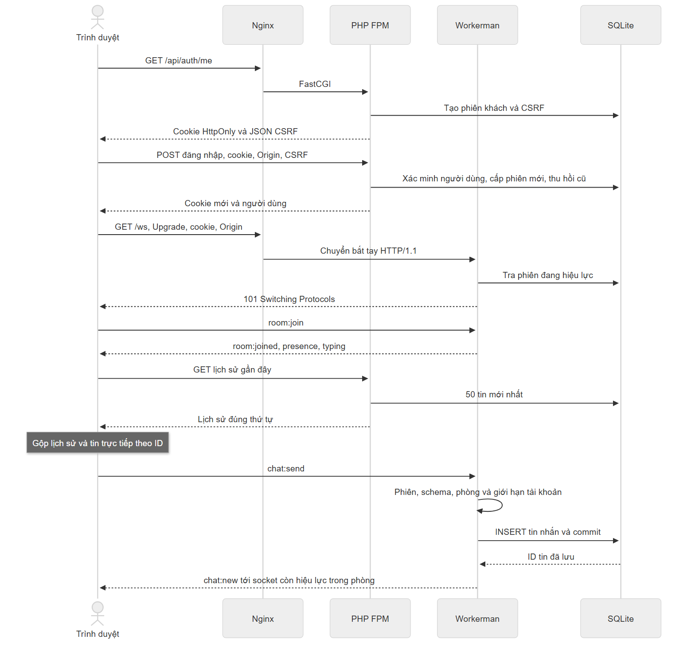

Máy chủ kiểm phiên/schema/phòng/giới hạn, INSERT/commit, ghi lượt rồi phát. Lỗi ghi không phát thành công/trừ lượt thành công. Đổi phòng dừng typing, abort HTTP, tăng thế hệ, xóa trạng thái cũ. Chỉ áp dụng phản hồi khớp thế hệ/roomId; máy chủ tham gia lặp không tạo trùng.

Bản nháp tách theo tài khoản/phòng trong localStorage, tự chuyển dữ liệu cũ từ sessionStorage và có RAM dự phòng khi bộ nhớ bị chặn. Đăng xuất xóa bản nháp của tài khoản. Giao diện/phòng gần nhất cũng dùng localStorage có bắt lỗi. Bộ nhớ trình duyệt hỗ trợ cá nhân, không thay lưu trữ máy chủ.

<!-- PAGE -->
# Chương 4 Triển khai kiểm thử và đánh giá

## 4.1 Môi trường và cài đặt

Môi trường gốc: Windows, Docker Desktop Linux containers, PHP 8.3.36, Workerman 5.2.3, PHPUnit 11.5.57, một select-loop worker. Composer khóa phiên bản. README có lệnh Windows/thủ công; setup dừng khi lỗi, sinh secret và seed.

Volume chung giải quyết quyền SQLite/WAL/SHM trên Windows. Cài sạch thử nguồn giải nén riêng với secret/volume/project mới, không mượn vendor. Điều này chứng minh môi trường đã thử, không phải mọi OS. Demo 8080/test 8088 tách dữ liệu; chạy tuần tự để không nhiễu giới hạn tài khoản.

Kiểm tra cài sạch có giá trị khác kiểm thử trong thư mục phát triển. Thư mục phát triển có thể vô tình dùng dependency đã có, secret đúng từ trước hoặc DB cũ đã có schema. Giải nén nguồn sang nơi riêng, tạo môi trường riêng rồi cài theo README giúp phát hiện các phụ thuộc ẩn. Không đưa vendor hoặc DB cá nhân vào gói để che thiếu hướng dẫn.

Các lệnh dừng/xóa ngăn xếp được phân biệt với xóa volume. Dừng rồi khởi động hoặc `down` thông thường giữ dữ liệu; `down -v` là thao tác khác và mất volume. Lệnh reset demo yêu cầu chuỗi xác nhận và chỉ cho local/test, đồng thời thu hồi phiên. Khi dùng trong trình bày phải giải thích rằng bộ đếm RAM của WS cũng cần khởi động lại, không gọi đó là một lần chạy bảo toàn dữ liệu.

## 4.2 Xác thực

Trang đăng nhập chờ `/api/auth/me` rồi mới bật đăng nhập/chọn mẫu/hiện mật khẩu để cookie/CSRF sẵn sàng. Kiểm tra bootstrap chậm xác nhận điều này.

Đầu vào giới hạn kiểu/kích thước. User lạ vẫn xác minh băm giả để không bỏ bước tốn thời gian. Sai thông tin trả lỗi chung tiếng Việt; đúng thì xoay và thu hồi phiên cũ. Test gồm cookie sửa/hết hạn/thu hồi, Origin/CSRF sai, hình dạng user và chặn WS. Logout đóng các socket cùng phiên.

## 4.3 Phòng trực tuyến và đang nhập

Hub gộp user ID từ socket/phòng. Hai socket một tài khoản vẫn một người; đóng một socket không xóa nếu còn socket khác. Typing hết hạn ba giây và dọn khi dừng/đổi/đóng. Trình duyệt hạn nhịp gửi, gửi dừng sau khoảng 2,8 giây; máy chủ không phụ thuộc sự kiện dừng.

Test kiểm cô lập, chưa vào phòng, phòng lạ, tham gia lặp. Cột phải/hộp thoại dùng cùng trạng thái; điện thoại vẫn xem được thành viên.

## 4.4 Lưu và chấp nhận

ChatService kiểm phòng/nội dung/giới hạn rồi repository INSERT. Autocommit hoàn tất trước Hub phát. Người gửi nhận cùng ID/thời gian với người khác. Test lỗi SQL xác nhận không phát/trừ lượt; phục hồi gửi lại thành công.

Restart HTTP/WS thật giữ tin/phiên bằng volume. Commit và quan sát vẫn có khoảng hở: máy chủ có thể dừng sau lưu nhưng trước echo. Lưu trước phát tránh tin ảo, chưa có idempotency. Không tự retry tin chưa rõ kết quả.

## 4.5 Trình duyệt và khôi phục

API/socket/chat tách nhiệm vụ. DOM dùng `textContent`; Map sắp ID gộp lịch sử/sự kiện. Abort/thế hệ loại phòng cũ phản hồi trễ.

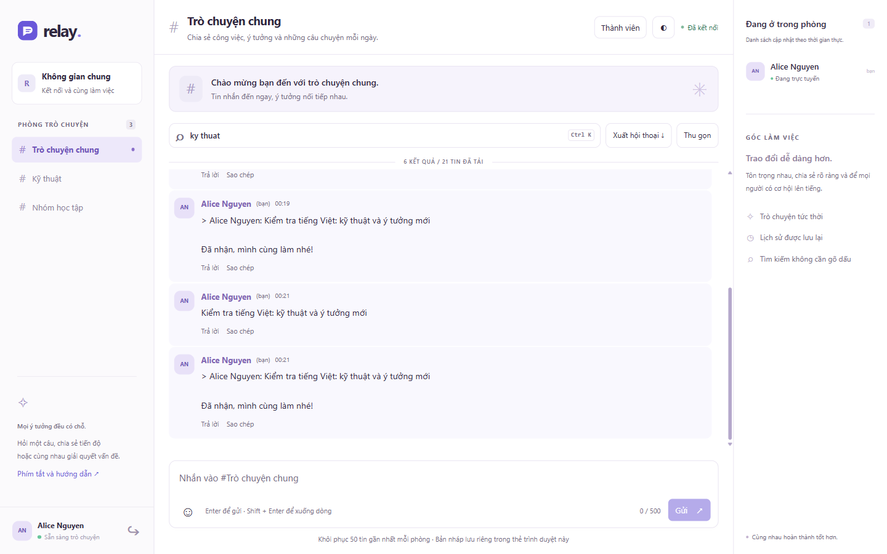

Mất mạng khóa Gửi nhưng vẫn soạn/lưu nháp. Nối lại vào phòng/tải trang mới nhất và có thể tải thêm trang cũ. Nội dung gửi chưa rõ giữ để kiểm, không tự phát lại. Test gốc gồm XSS văn bản, offline/online, gộp ID, phòng trễ/logout chung; đợt cập nhật kiểm bản nháp sau reload, tìm/xuất toàn lịch sử và giao diện nhiều kích thước.

Một tình huống cần kiểm riêng là nhiều thẻ cùng hồ sơ. Chúng dùng cùng cookie, do đó không thể dùng làm hai người giả lập độc lập. Khi một thẻ đăng xuất, các socket dùng phiên đó phải bị thu hồi và trang còn lại trở về đăng nhập. Bài kiểm tra mở thẻ phụ, đăng xuất ở đó và chờ thẻ ban đầu chuyển trang để xác nhận hành vi thực trong trình duyệt.

Khi không tải được lịch sử, máy khách giữ trạng thái phòng hiện tại và hiển thị cách thử lại bằng chọn phòng. Yêu cầu bị hủy vì chuyển phòng không được báo như lỗi dịch vụ. Mã lỗi mạng từ fetch được chuyển sang lời tiếng Việt; AbortError vẫn giữ riêng để không làm sai luồng hủy yêu cầu. Đây là chi tiết giúp lỗi dễ hiểu nhưng không thay cơ chế xác thực máy chủ.

## 4.6 Dữ liệu giới hạn và heartbeat

Validator từ chối JSON/schema/trường/kiểu/sự kiện sai, rỗng/quá dài. Tiếp hợp từ chối nhị phân phân mảnh; Workerman xử lý khung và có thể đóng trước lỗi JSON. Cửa sổ trượt cho 20 tin chấp nhận/60 giây/tài khoản dùng mọi socket; chỉ ghi lượt sau INSERT.

Gateway ping mỗi 20 giây, dọn thiếu pong khoảng 55–56 giây. Peer thật cố ý không pong đo 55,828 giây; phụ thuộc nhịp kiểm tra, không cam kết chính xác mili giây. Phiên cũng kiểm định kỳ/trước giao.

## 4.7 Chiến lược kiểm thử

| Lớp | Kết quả gốc ngày 22/10/2026 | Phạm vi ban đầu |
| --- | --- | --- |
| PHPUnit | 28 bài, 78 xác nhận đạt | Phiên, validator, hub, limiter, SQL, lỗi ghi |
| Tích hợp | 7/7 nhóm đạt | Auth, phòng, presence, payload, limit, logout, đồng thời |
| Trình duyệt | Các kịch bản ghi log | Văn bản an toàn, nối lại, gộp, phòng trễ |
| Runtime | Restart giữ tin, dọn không pong | Tiến trình/peer thật |
| Cài sạch | Nguồn giải nén cài được | Secret/volume/thư viện mới |
| Đồng thời | 20/100/200 bản nhận đủ | Mười tin tới 2/10/20 socket |

JUnit/JSON/dữ liệu thô chứng minh kết quả; ảnh chỉ mô tả giao diện. Phần thủ công chưa thử vẫn để mở. Test không thay video/đóng góp thật. Bản sửa ngày 28/10 có log Việt hóa riêng; hồi quy 05/11 được tổng kết tại mục 4.12, log gốc tiếp tục giữ ngày cũ.

Các tình huống chi tiết dưới đây liên kết yêu cầu với loại minh chứng. Bảng ghi phạm vi đã thực hiện ở lần kiểm chứng gốc; kết quả sau sửa dùng log mới. Trường hợp TLS chỉ hoàn thành một phần, không chuyển thành đạt toàn bộ vì cờ cookie hoặc cấu hình proxy có trong mã.

| Ca | Phạm vi kiểm tra | Minh chứng |
| --- | --- | --- |
| TC-01 | Đăng nhập đúng/sai, API khách, xoay cookie, cấu trúc user | Tích hợp auth, unit phiên |
| TC-02 | Cookie khách/sửa/thu hồi bị chặn WS; hết hạn trong unit | Tích hợp auth, unit hạn |
| TC-03 | Origin/CSRF sai bị từ chối | Tích hợp auth |
| TC-04 | Người gửi/nhận cùng ID đã lưu | Tích hợp chat |
| TC-05 | Cô lập chat/typing/presence, phòng lạ/chưa tham gia | Tích hợp phòng, Hub |
| TC-06 | Nhiều socket cùng tài khoản gộp đúng | Presence, Hub |
| TC-07 | Tham gia lặp và phản hồi phòng cũ tới muộn | Phòng, trình duyệt |
| TC-08 | Offline khóa gửi, online tham gia/gộp ID | Trình duyệt |
| TC-09 | Biên 500/501 Unicode, rỗng sau cắt trắng | Payload, Validator |
| TC-10 | JSON/schema/nhị phân/phân mảnh/quá cỡ | Tích hợp giao thức |
| TC-11 | Giới hạn tài khoản qua nhiều socket, không lưu tin chặn | Limit, đồng hồ unit |
| TC-12 | TTL nhập, dọn đóng, peer không pong | Presence, runtime |
| TC-13 | SQL-like là dữ liệu, script-like không chạy | Repository, trình duyệt |
| TC-14 | Logout thu hồi socket/HTTP cùng phiên | Tích hợp, trình duyệt |
| TC-15 | Cờ cookie/API/cổng; TLS công khai chưa thử | Hoàn thành một phần |
| TC-16 | Restart giữ dấu tin/phiên, thứ tự 50 tin mới | Runtime, repository |
| TC-17 | Ghi lỗi không phát/trừ lượt thành công | ChatTest |
| TC-18 | Cài từ nguồn riêng với thư viện/volume/secret mới | Clean install |
| TC-19 | Sáu lượt đo, hai lượt nhàn rỗi, 120/120 tin | Dữ liệu thô |
| TC-20 | Mười tin tới 2/10/20 socket đủ bản giao | Concurrent |

Phân tầng giúp xác định lỗi nhanh hơn. Unit dùng dữ liệu trong bộ nhớ và đồng hồ kiểm soát, tích hợp dùng cookie/socket thật và máy chủ riêng, trình duyệt xác nhận thao tác/DOM, runtime xác nhận quá trình thật. Không có lớp nào tự thay các lớp còn lại: unit đúng không chứng minh proxy chuyển Upgrade, ảnh đúng không chứng minh cookie thu hồi, kiểm tải nhẹ không chứng minh năng lực production.

## 4.8 Phương pháp đo

Test 8088 dùng cùng người gửi WS/DB/phòng. Mỗi kênh nhận ba lượt 120 giây, thứ tự xen kẽ. Gửi 20 dấu riêng cách sáu giây, bắt đầu 0,17 giây; polling mỗi giây, lệch đầu 0,55 giây. Kết nối/đăng nhập ngoài cửa sổ.

`time.perf_counter` cùng Python ghi gửi/nhận. Độ trễ gồm kiểm/lưu/phát hoặc chờ polling, loopback, lịch điều phối; không gọi độ trễ mạng thuần. Giữ lỗi/timeout. Tính trung vị/p95 hạng gần nhất; 20 mẫu chỉ mô tả.

Đếm HTTP/sự kiện WS/byte JSON, bỏ header/TCP/khung/TLS. Mỗi kênh thêm 60 giây nhàn rỗi. `--quick` là sơ bộ, không thay sáu lượt cuối.

## 4.9 Kết quả và diễn giải

<!-- BENCHMARK_RESULTS -->

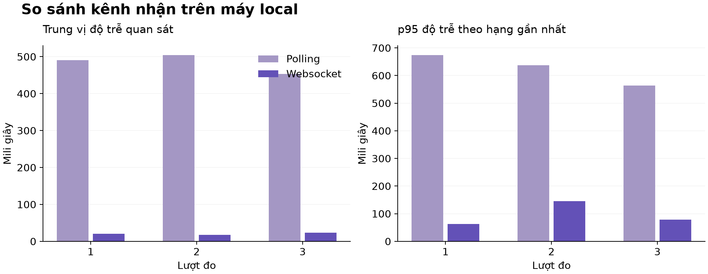

Trung vị polling 452,95–504,52 ms; WS 17,63–23,73 ms. Mỗi lượt 20/20, tổng 120/120, không timeout/lỗi máy chủ ghi nhận. Ba lượt polling hoạt động có 360 yêu cầu nhận. Kết quả phù hợp chờ lượt hỏi so với đẩy trên kênh mở trong cấu hình này.

Không suy thành quy luật mọi môi trường: chu kỳ, mạng, tải ghi/proxy/CPU ảnh hưởng. Máy vẫn có build nên chưa cô lập nhiễu. WS nhận cả trạng thái phòng nên byte khác lớp nội dung polling, chưa là băng thông bằng tải tương đương.

Nhàn rỗi minh họa polling vẫn hỏi, WS mở với điều khiển không tính sự kiện ứng dụng. Chưa đo CPU/RAM, byte trên dây, WAN hoặc sức chứa tối đa.

Bộ đo lưu bản ghi riêng từng tin, tóm tắt từng lượt và thông tin môi trường để có thể tính lại các đại lượng. Giá trị trung vị mô tả vùng giữa, p95 nhấn mạnh phần chậm hơn nhưng với 20 mẫu thì độ ổn định hạn chế. Kết luận nên bám vào phạm vi quan sát thay vì chỉ nhấn mạnh một số nhỏ hoặc một tỷ lệ lớn giữa hai phương thức.

Việc nhận đủ mọi tin trong sáu lượt chứng minh phép thử không bỏ mất dấu đã ghi trong cửa sổ đó. Nó không loại mọi khả năng mất hoặc trùng trong khoảng gián đoạn dài. Phép đo cũng không thay các bài phân quyền: một đường nhận nhanh nhưng phát nhầm phòng vẫn là sai chức năng. Do đó dữ liệu so sánh phải được đọc cùng kết quả tích hợp và giới hạn khôi phục.

## 4.10 Đồng thời và vận hành

Mười tin ở 2/10/20 socket nhận đủ 20/100/200 theo ID. Có socket cùng tài khoản; đây là fanout/membership, không số người độc lập hoặc thông lượng tối đa.

Restart mất trạng thái RAM; client nối lại/nhập phòng/tải lịch sử, DB còn tin/phiên. Bộ đếm reset cần giải thích trong demo/test. Lỗi quyền SQLite dẫn chọn volume; bộ chạy sửa IPv4 và nhận diện từng tin, rồi chạy lại tuần tự để phân biệt lỗi harness với ứng dụng.

## 4.11 Trải nghiệm tiếng Việt

Việt hóa tiêu đề, nhãn, placeholder, trợ năng, trạng thái và lỗi HTTP/WS. Tên sự kiện/trường/mã/lệnh giữ nguyên. Ba tên phòng dịch ở trình bày để tương thích dữ liệu.

Tìm chuẩn hóa dấu và đ/Đ trên tên/nội dung của toàn bộ lịch sử trong phòng, phân trang khi có thêm kết quả. Tải lịch sử cũ hơn theo từng trang tối đa 50 tin. Xuất TXT UTF-8 duyệt toàn bộ lịch sử phòng, không chỉ tin đang tải trên màn hình hoặc đang lọc; kèm tên/thời gian theo định dạng Việt Nam. Trả lời chèn trích dẫn tối đa 120 mã ký tự, tính trong 500; trích dẫn vẫn là văn bản và không tạo liên kết bền vững.

Tài khoản đăng ký được kiểm tra cùng xoay phiên; bạn bè có thể mở tin riêng hai người. Nhóm riêng hỗ trợ đổi tên, thêm/xóa thành viên, rời nhóm và xóa nhóm; quyền lịch sử/socket bị thu hồi khi thành viên bị xóa. Nháp localStorage tách tài khoản/phòng, chuyển dữ liệu cũ và xóa khi đăng xuất. Bị chặn lưu thì RAM; xóa dữ liệu trình duyệt vẫn có thể làm mất nháp. Sáng/tối/thu gọn/phòng gần nhất nhớ localStorage. Thành viên mở hộp thoại trên điện thoại; phím tắt/sao chép/emoji/về cuối giảm thao tác. Kiểm nhiều kích thước không thay kiểm toán tiếp cận toàn diện.

## 4.12 Hồi quy sau hoàn thiện chức năng ngày 05/11/2026

Kiểm tra cuối được chạy trên stack HTTP/WebSocket riêng và cơ sở dữ liệu mẫu mới, không reset cơ sở dữ liệu demo ở cổng 8080. `composer test` đạt 40/40 bài với 135 xác nhận; `composer lint` kiểm tra 47 tệp PHP; `composer validate --strict` hợp lệ. Bộ tích hợp đạt 9/9 nhóm gồm xác thực, đăng ký, quyền phòng/lịch sử, trò chuyện riêng, vòng đời nhóm, presence/typing, ranh giới Unicode/giao thức, logout, 2/10/20 socket và giới hạn gửi. Kịch bản trình duyệt hoàn tất 14/14 bước, không có lỗi JavaScript.

Kiểm tra môi trường demo cũ phát hiện thiếu bảng `direct_chats`, làm API phòng trả 503. `bin/migrate-social.php` chạy `CREATE TABLE IF NOT EXISTS` từ schema hiện tại; sau đó API health và phòng đều trả 200, kết nối WebSocket hoạt động và sáu phòng cũ vẫn hiển thị. Không xóa volume hoặc hội thoại. Đây là bước cần chạy khi nâng cấp cơ sở dữ liệu đã có dữ liệu; log trước/sau nằm ở `evidence/logs/final-run-2026-11-05-migration.json`.

Các thao tác trình duyệt gồm đăng ký và tự đăng nhập; kết bạn, mở tin riêng và chặn truy cập từ tài khoản ngoài; tạo/đổi tên nhóm, thêm/xóa thành viên, rời/xóa nhóm; tải tin cũ, tìm dấu mốc cũ, tải tệp xuất đủ 121 tin trong phòng thử; giữ nháp sau reload; xác nhận toast không giao với vùng soạn trên điện thoại; kiểm chiều ngang ở 390×844 và 1440×900. Dữ liệu tích hợp và trình duyệt được lưu ở `evidence/logs/final-run-2026-11-05-integration.json` và `final-run-2026-11-05-browser.json`; PHPUnit ở `final-run-2026-11-05-phpunit.xml`.

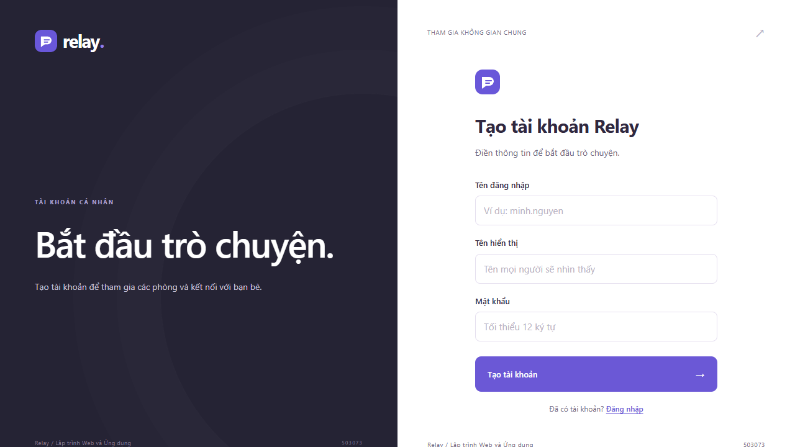

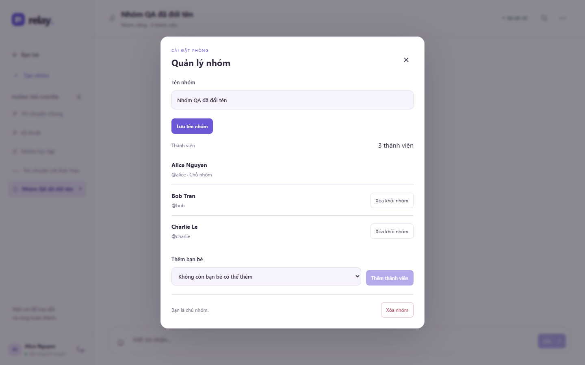

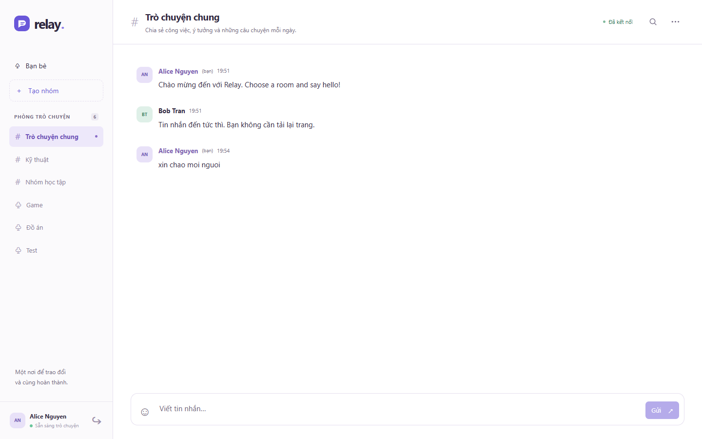

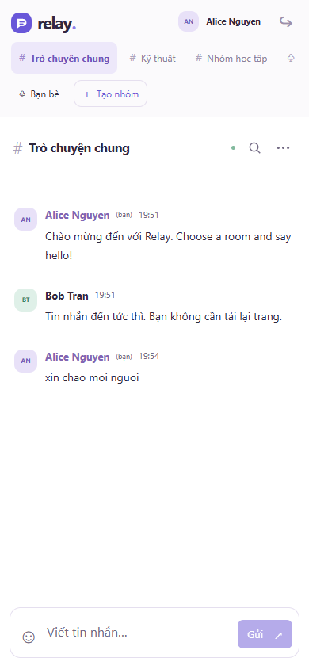

## 4.13 Kiểm chứng chức năng trên môi trường demo ngày 06/11/2026

Lượt kiểm chứng ngày 06/11/2026 được chạy trực tiếp trên stack demo đang hoạt động tại http://localhost:8080, tức đúng ba dịch vụ Docker Compose mà README mô tả: nginx 1.28-alpine làm proxy, PHP-FPM 8.3 xử lý HTTP và SQLite, và một tiến trình PHP CLI chạy Workerman làm máy chủ WebSocket. Trình duyệt điều khiển là Chromium headless qua Playwright trên Windows. Bốn ngữ cảnh trình duyệt độc lập được mở đồng thời để có bốn danh tính thật cùng lúc: alice, bob, charlie và một tài khoản đăng ký mới ngay trong lượt chạy. Hai viewport được dùng: 1440×900 cho máy tính và 390×844 với mật độ điểm ảnh nhân đôi cho điện thoại.

Lượt chạy hoàn tất với 52 khẳng định đạt, 32 ảnh chụp màn hình, 136 khung WebSocket được ghi nguyên văn và 0 lỗi JavaScript trong console; danh sách vấn đề gặp phải là rỗng. Toàn bộ kết quả nằm ở evidence/logs/run-2026-11-06-ui.json, ảnh ở evidence/screenshots/run-2026-11-06/ và khung giao thức ở evidence/raw/run-2026-11-06-websocket.jsonl. Mỗi con số trong mục này đều được đọc trực tiếp từ các tệp đó thay vì nhập tay.

Kịch bản đi hết vòng đời của các chức năng mới: đăng ký tài khoản bằng giao diện và được máy chủ cấp phiên rồi chuyển thẳng vào phòng; tìm người theo tên hoặc tên đăng nhập có hỗ trợ gõ không dấu; gửi và chấp nhận lời mời kết bạn với huy hiệu lời mời đến; mở tin nhắn riêng hai người với tên phòng cá nhân hóa theo từng phía; tạo nhóm riêng ba thành viên và trao đổi tin theo thời gian thực giữa ba người; phân biệt quyền chủ nhóm với thành viên thường trong hộp thoại quản lý; xóa thành viên rồi xác nhận quyền đọc lịch sử bị thu hồi bằng mã HTTP 404; xuất hội thoại ra tệp UTF-8 có BOM; kiểm bố cục điện thoại không tràn ngang; và ngắt mạng rồi để ứng dụng tự kết nối lại theo backoff.

| Tình huống | Kết quả mong đợi | Kết quả thực nhận |
| --- | --- | --- |
| Đăng ký tài khoản với mật khẩu ngắn hơn 12 byte | HTTP 400, mã lỗi INVALID_PASSWORD | 400 |
| Yêu cầu lịch sử phòng với limit vượt quá 50 | HTTP 400 | 400 |
| Yêu cầu POST mang Origin ngoài danh sách cho phép | HTTP 403 | 403 |
| Thao tác quản lý nhóm với CSRF token sai | HTTP 403 | 403 |
| Tài khoản ngoài cuộc đọc lịch sử phòng riêng | HTTP 404 | 404 |
| Người ngoài nhóm gọi thao tác quản lý nhóm | HTTP 404 | 404 |
| Chủ nhóm thêm một người chưa kết bạn vào nhóm | HTTP 400 | 400 |
| Gửi tin 501 mã ký tự Unicode qua WebSocket | system:error, mã MESSAGE_TOO_LONG | MESSAGE_TOO_LONG |
| Gửi loại sự kiện không có trong hợp đồng qua WebSocket | system:error, mã INVALID_PAYLOAD | INVALID_PAYLOAD |
| Gọi API đo so sánh khi BENCHMARK_ENABLED=0 | HTTP 404 | 404 |

Sáu hình dưới đây là ảnh chụp thật của lượt chạy, mỗi hình tương ứng một trạng thái đã được khẳng định ở trên. Bộ ảnh đầy đủ gồm 32 ảnh được lưu và chú thích đầy đủ ở Phụ lục B.

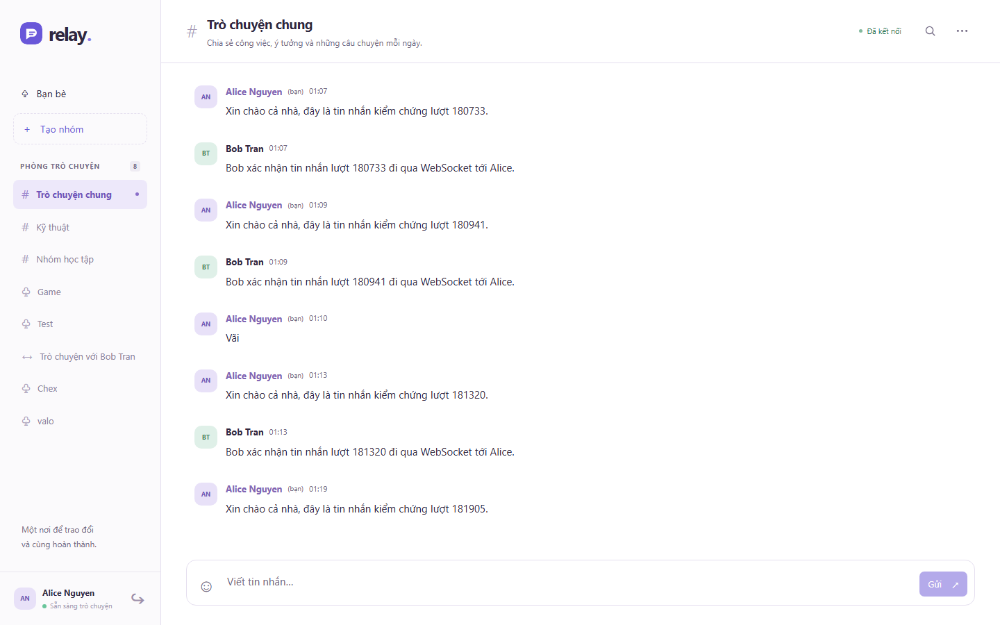

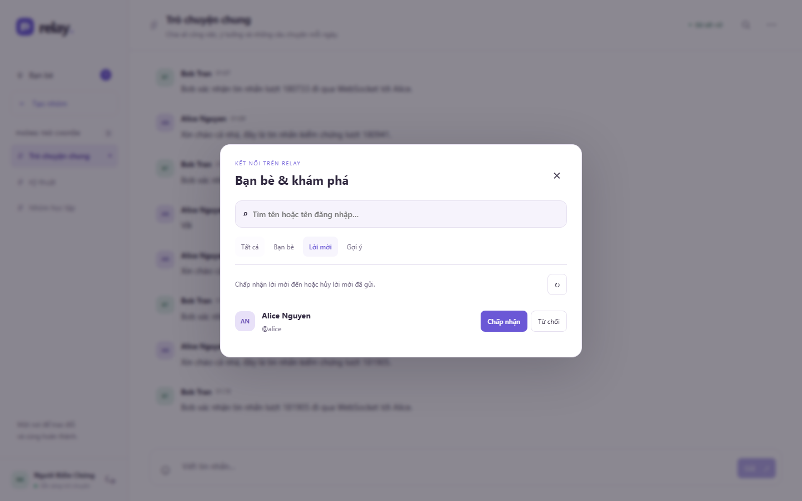

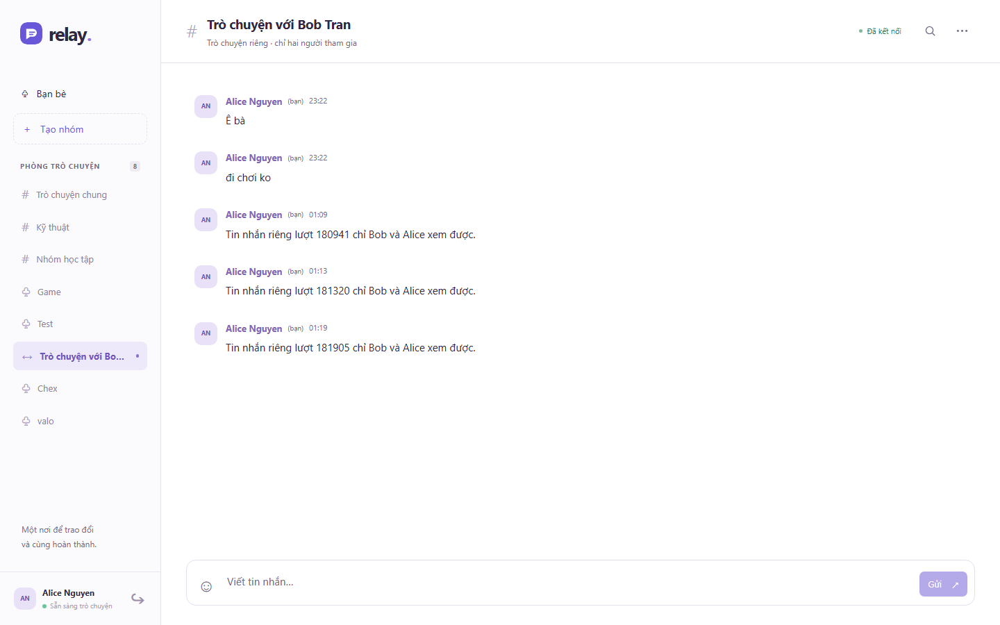

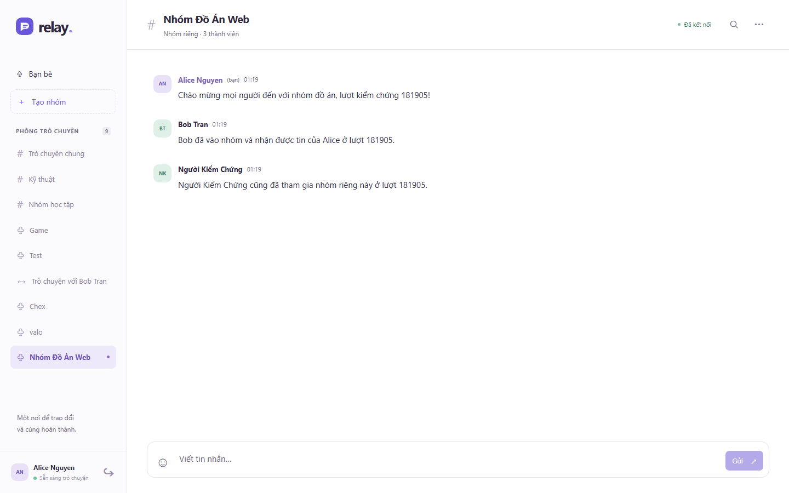

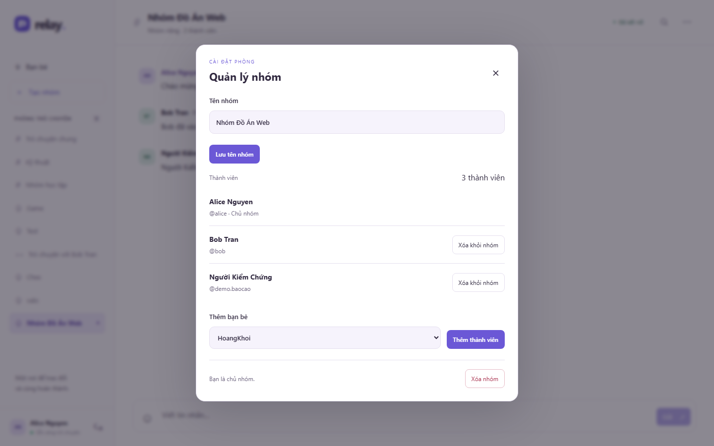

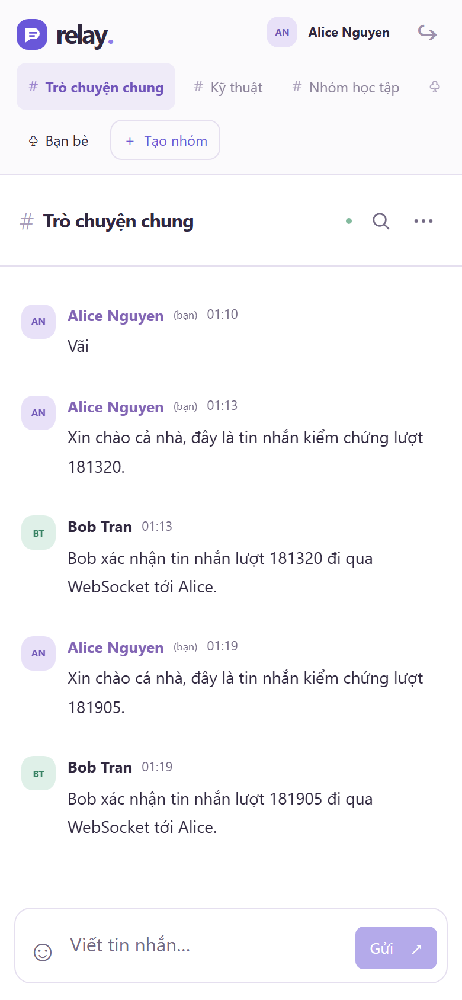

<!-- PAGE -->
# Chương 5 Kết luận và hướng phát triển

Một bài học triển khai là cần làm rõ thời điểm trạng thái thay đổi. Bấm Gửi chưa có nghĩa máy chủ chấp nhận, socket mở chưa có nghĩa đã vào phòng, và thấy trạng thái offline chưa có nghĩa bản tin cuối chưa lưu. Giao diện phải dùng xác nhận phù hợp và thông báo khi chưa biết chắc. Việc giữ nháp theo phòng giảm thao tác lặp, nhưng tránh thêm hành vi tự gửi có thể làm trùng dữ liệu.

Bản cập nhật giữ logic truyền trong ChatSocket và logic công cụ trong chat/preferences để phạm vi thay đổi dễ kiểm tra. Bộ kiểm mới thao tác như người dùng: điền ô, bấm nút, tải lại, đổi phòng, đổi kích thước và ngắt mạng. Nó kiểm nội dung xuất/bộ nhớ tạm, không chỉ tìm tên tính năng trong mã. Những phần chưa có kết quả thực được giữ ở trạng thái còn cần kiểm tra.

## 5.1 Đánh giá mục tiêu

Relay nối danh tính, hợp đồng, phòng, lưu trước phát, vòng đời, UI và kiểm chứng. Hai tài khoản trao đổi không tải lại, phòng cô lập, phiên thu hồi, tin giữ qua restart, client gộp ID.

Tiếng Việt giúp hiểu/thao tác, giữ hợp đồng kỹ thuật. Tìm/nháp/xuất hỗ trợ công việc; phân trang và quyền phạm vi phòng được làm rõ. Hai mươi socket không là sức chứa production, Map không bảo đảm lưu một lần, trang 50 tin không phát lại mọi sự kiện vô hạn, cookie/Origin không là chứng nhận bảo mật.

## 5.2 Giới hạn

Trạng thái một worker mất khi restart; cần trạng thái chung/pub-sub để mở rộng. SQLite ghi đồng bộ có thể chặn vòng lặp. Chưa có cursor/khóa chống lặp, commit trước disconnect vẫn gây chưa rõ kết quả; bản nháp không xác định máy chủ đã lưu.

Đo local nhỏ, chu kỳ chọn trước, máy chung và lớp JSON khác nhau. Chưa đo byte toàn tuyến, tài nguyên/WAN/nhiều máy/churn dài. HTTPS công khai chưa kiểm chứng; chưa có tải tệp, vai trò quản trị, kiểm duyệt, thông báo tin chưa đọc, kiểm toán trợ năng hoặc bảo đảm gửi đúng một lần khi mất kết nối. Tài khoản mẫu dành lớp học.

## 5.3 Phát triển

Thêm ID thao tác máy khách và ràng buộc duy nhất máy chủ để retry không lưu trùng. Bổ sung nhãn/chỉ báo tin chưa đọc, tải tệp an toàn, kiểm duyệt và vai trò quản trị theo chính sách triển khai.

Nhiều worker cần presence/limiter chung/pub-sub, vẫn kiểm phiên tại từng worker. Đo DB theo tải, hạn hàng đợi/chính sách nhận chậm. Vận hành cần TLS, tài khoản, log an toàn, sao lưu/phục hồi, giám sát.

Có thể thêm chưa đọc, quyền phòng/tìm máy chủ khi xác định phạm vi. Đánh giá tiếp kiểm soát mạng, đồng nhất nội dung đo byte, lấy tài nguyên và tăng mẫu đuôi; so SSE nếu câu hỏi luồng một chiều. Thời gian thực là hành vi hệ thống, không chỉ mở socket.

<!-- PAGE -->
# Tài liệu tham khảo

[1] IETF. RFC 6455 The WebSocket Protocol. Tháng 12/2011. https://www.rfc-editor.org/rfc/rfc6455.html . Truy cập 22/10/2026.

[2] WHATWG. HTML Living Standard Server-sent events. https://html.spec.whatwg.org/multipage/server-sent-events.html . Truy cập 22/10/2026.

[3] Mozilla MDN. WebSocket API. https://developer.mozilla.org/en-US/docs/Web/API/WebSocket . Truy cập 22/10/2026.

[4] OWASP. WebSocket Security Cheat Sheet. https://cheatsheetseries.owasp.org/cheatsheets/WebSocket_Security_Cheat_Sheet.html . Truy cập 22/10/2026.

[5] Workerman. About WebSocket. https://manual.workerman.net/doc/en/appendices/about-websocket.html . Đối chiếu thư viện 5.2.3 khóa Composer. Truy cập 22/10/2026.

[6] PHP Manual. PDO prepare. https://www.php.net/manual/en/pdo.prepare.php . Truy cập 22/10/2026.

[7] PHP Manual. password_hash. https://www.php.net/manual/en/function.password-hash.php . Truy cập 22/10/2026.

[8] SQLite. Write-Ahead Logging. https://sqlite.org/wal.html . Truy cập 22/10/2026.

[9] Nginx. WebSocket proxying. https://nginx.org/en/docs/http/websocket.html . Truy cập 22/10/2026.

Nguồn yêu cầu môn: đề giữa kỳ 503073, học kỳ 1 năm 2026–2027, 11 trang; chủ đề 9 trang 5–6, yêu cầu 6–9, điểm 9–10, chính sách nhóm 11. Việt hóa theo yêu cầu 28/10/2026 không sửa quy định ngôn ngữ đề gốc; đối chiếu khi nộp.

<!-- PAGE -->
# Phụ lục A Tái lập và minh chứng

README có cài đặt/cấu hình/tài khoản/test. Windows dùng setup.ps1; thủ công Compose/Composer khóa. Alice/bob/charlie giả lập; dùng hồ sơ riêng vì thẻ chung phiên.

| Vị trí | Nội dung |
| --- | --- |
| docs/contracts.md | HTTP/WS, kiểu/lỗi/giới hạn |
| database/schema.sql và seed.php | Mô hình, seed không trùng |
| tests và phpunit.xml | Kiểm PHP dữ liệu riêng |
| tools/integration.py | Auth, đăng ký, phòng, tin riêng, nhóm, payload, logout, limit, fanout |
| tools/browser-acceptance.js | DOM, ngoại tuyến, gộp, phòng trễ, phiên |
| tools/full-browser-check.js | Quy trình đăng ký, tin riêng, nhóm, lịch sử, nháp và responsive |
| tools/vietnamese-ui-check.js | Nháp, tìm, trích dẫn, xuất, tùy chọn, kích thước |
| tools/verify-runtime.py | Restart thật, peer không pong |
| tools/benchmark/run.py | Đo đường nhận |
| evidence/logs và raw | Kết quả/ngày/môi trường, từng lượt/tin, hồi quy và migration 05/11/2026, kiểm chứng giao diện và khung WebSocket 06/11/2026 |
| evidence/diagrams và screenshots | Sơ đồ và ảnh thật; 4 ảnh giao diện bản hoàn thiện; 32 ảnh kiểm chứng ngày 06/11/2026 trong thư mục con run-2026-11-06 |
| tools/build-report-insert.js và insert-report-section.ps1 | Sinh đặc tả từ log kiểm chứng rồi chèn mục 4.13/Phụ lục B vào báo cáo Word bằng Word COM |
| docs/huong-dan-su-dung.md | Hướng dẫn tiếng Việt |

Đọc nguồn cùng log: tên bài dự kiến không chứng minh đã chạy, ảnh không thay giao thức. Manifest xác định sản phẩm/phần thiếu. Chưa có đóng góp/thuyết trình thật/nộp chính thức; thông tin lớp/người để trống theo yêu cầu.
<!-- PAGE -->
# Phụ lục B Ảnh chụp kiểm chứng giao diện ngày 06/11/2026

Phụ lục này lưu toàn bộ 32 ảnh chụp màn hình của lượt kiểm chứng ngày 06/11/2026 theo đúng thứ tự kịch bản, kèm chú thích mô tả trạng thái được chụp. Ảnh do Chromium headless chụp trực tiếp từ phản hồi của máy chủ tại http://localhost:8080; không ảnh nào là ảnh dựng sẵn hoặc qua chỉnh sửa. Tệp hội thoại xuất được trong lượt chạy cũng nằm cùng thư mục với tên bắt đầu bằng xuat-.

Để tái hiện, khởi động stack theo README rồi chạy script tmp/pw-shot/capture-report-run.js; dữ liệu demo của lượt trước được dọn trước mỗi lượt bằng tmp/pw-shot/cleanup-demo.php chạy trong container app. Thư mục tmp không nằm trong gói nộp, còn toàn bộ minh chứng trong phụ lục này thì có.

| Ảnh | Tệp trong evidence/screenshots/ | Chú thích |
| --- | --- | --- |
| Ảnh B1 | run-2026-11-06/R01-dang-nhap.png | Trang đăng nhập với ba tài khoản mẫu dùng thử |
| Ảnh B2 | run-2026-11-06/R02-dang-ky-dien-form.png | Form đăng ký tài khoản mới đã điền đủ ba trường bắt buộc |
| Ảnh B3 | run-2026-11-06/R03-phong-chung-desktop.png | Phòng "Trò chuyện chung" trên desktop, trạng thái Đã kết nối, tin vừa gửi đã được máy chủ lưu và phát lại |
| Ảnh B4 | run-2026-11-06/R04-thanh-vien-truc-tuyen.png | Hộp thoại Thành viên liệt kê người đang trực tuyến trong phòng, gộp nhiều thẻ của cùng tài khoản |
| Ảnh B5 | run-2026-11-06/R05-chi-bao-dang-nhap.png | Chỉ báo "Bob Tran đang nhập…" đẩy realtime sang Alice bằng sự kiện room:typing |
| Ảnh B6 | run-2026-11-06/R06-hai-nguoi-trao-doi.png | Cuộc trao đổi hai chiều giữa Alice và Bob trong cùng phòng công khai |
| Ảnh B7 | run-2026-11-06/R07-tim-kiem-lich-su.png | Tìm kiếm toàn bộ lịch sử phòng với từ khóa không dấu, kèm nhãn số kết quả |
| Ảnh B8 | run-2026-11-06/R08-ban-be-tat-ca.png | Hộp thoại Bạn bè & khám phá, tab Tất cả liệt kê mọi người dùng khác kèm số bạn chung và nhóm chung |
| Ảnh B9 | run-2026-11-06/R09-ban-be-da-ket-noi.png | Tab Bạn bè với nhãn "✓ Bạn bè" và nút Nhắn tin / Hủy kết bạn |
| Ảnh B10 | run-2026-11-06/R10-ban-be-tim-kiem.png | Ô tìm bạn bè lọc theo tên hoặc tên đăng nhập, hỗ trợ gõ không dấu |
| Ảnh B11 | run-2026-11-06/R11-dang-ky-thanh-cong.png | Tài khoản mới đăng ký thành công, được chuyển thẳng vào phòng chat với phiên đã cấp |
| Ảnh B12 | run-2026-11-06/R12-tim-khong-dau.png | Gõ không dấu "kiem chung" vẫn tìm ra "Người Kiểm Chứng" nhờ chuẩn hóa dấu trong SocialRepository::normalize |
| Ảnh B13 | run-2026-11-06/R13-loi-moi-da-gui.png | Trạng thái outgoing sau khi gửi lời mời, kèm nút Hủy lời mời |
| Ảnh B14 | run-2026-11-06/R14-loi-moi-den.png | Tab Lời mời ở phía người nhận, hiển thị lời mời đến từ Alice với hai nút Chấp nhận / Từ chối |
| Ảnh B15 | run-2026-11-06/R15-da-ket-ban.png | Sau khi chấp nhận, tab Bạn bè của người nhận hiển thị Alice với nhãn "✓ Bạn bè" |
| Ảnh B16 | run-2026-11-06/R16-goi-y.png | Tab Gợi ý xếp hạng theo số bạn chung rồi tới số nhóm riêng chung |
| Ảnh B17 | run-2026-11-06/R17-tin-nhan-rieng.png | Hội thoại tin nhắn riêng, biểu tượng ↔ trên danh sách phòng và mô tả "Trò chuyện riêng · chỉ hai người tham gia" |
| Ảnh B18 | run-2026-11-06/R18-nguoi-ngoai-khong-thay-phong.png | Danh sách phòng của Charlie không chứa nhóm riêng hay tin nhắn riêng của người khác |
| Ảnh B19 | run-2026-11-06/R19-tao-nhom.png | Hộp thoại Tạo nhóm với tên nhóm, danh sách bạn bè được chọn và bộ đếm "3 thành viên, gồm bạn" |
| Ảnh B20 | run-2026-11-06/R20-nhom-rieng.png | Nhóm riêng "Nhóm Đồ Án Web" với biểu tượng ♧, mô tả số thành viên và tin nhắn từ ba người |
| Ảnh B21 | run-2026-11-06/R21-quan-ly-nhom.png | Hộp thoại Quản lý nhóm ở vai chủ nhóm: đổi tên, danh sách thành viên, thêm bạn, rời/xóa nhóm |
| Ảnh B22 | run-2026-11-06/R22-thanh-vien-thuong.png | Cùng hộp thoại ở vai thành viên thường: các nút của chủ nhóm bị ẩn, chỉ còn Rời nhóm |
| Ảnh B23 | run-2026-11-06/R23-xoa-thanh-vien.png | Sau khi chủ nhóm xóa thành viên, danh sách còn 2 người và nút "Xóa khỏi nhóm" biến mất với thành viên còn lại |
| Ảnh B24 | run-2026-11-06/R24-mat-quyen-sau-khi-bi-xoa.png | Thành viên bị xóa khỏi nhóm không còn thấy nhóm trong danh sách phòng |
| Ảnh B25 | run-2026-11-06/R25-giao-dien-toi-thu-gon.png | Giao diện tối kèm chế độ thu gọn tin nhắn, cả hai được nhớ trong localStorage |
| Ảnh B26 | run-2026-11-06/R26-huong-dan-phim-tat.png | Hộp thoại hướng dẫn và phím tắt của ứng dụng |
| Ảnh B27 | run-2026-11-06/R27-tra-loi-va-emoji.png | Khung trả lời trích dẫn tin gốc và bộ chọn biểu tượng cảm xúc trong ô soạn |
| Ảnh B28 | run-2026-11-06/R28-mobile-chat.png | Giao diện chat trên viewport điện thoại 390×844, thanh bên thu thành ngăn kéo |
| Ảnh B29 | run-2026-11-06/R29-mobile-ban-be.png | Hộp thoại Bạn bè trên điện thoại vẫn nằm gọn trong chiều rộng màn hình |
| Ảnh B30 | run-2026-11-06/R30-mobile-thanh-vien.png | Danh sách thành viên trực tuyến trên điện thoại |
| Ảnh B31 | run-2026-11-06/R31-mat-ket-noi.png | Trạng thái mất kết nối, nút Gửi bị khóa để tránh gửi tin không xác định |
| Ảnh B32 | run-2026-11-06/R32-ket-noi-lai.png | Kết nối được khôi phục tự động, không cần người dùng tải lại trang |
